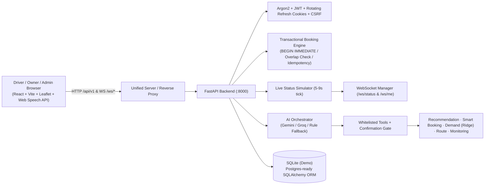

# ChargeKaro — AI-Powered EV Charging Discovery & Booking Platform (Demo)

> **Demo Notice:** All 12 Delhi-NCR charging stations, charger telemetry streams, vehicle records, and UPI/card checkouts are **fictional demo data** generated by `backend/seed.py` and the background live simulator. No real chargers or real payment rails are connected.

ChargeKaro solves EV range and charger-availability anxiety across Delhi-NCR by combining **gun-level live WebSocket telemetry**, **transactional 30-minute slot booking with strict double-booking prevention**, **QR check-in with live session metering**, and **5 specialized tool-calling AI & Voice agents** (supporting English, Hindi, and Hinglish).

---

## Demo Credentials

| Role | Email | Password | Portal Access |
| :--- | :--- | :--- | :--- |
| **Driver** | `driver@chargekaro.demo` | `Driver@123!` | Live Map, Booking, QR Check-In, Live Session, AI Voice |
| **Station Owner** | `owner@chargekaro.demo` | `Owner@123!` | Owner Dashboard, Pricing, Maintenance, Heatmaps, AI Demand |
| **Admin** | `admin@chargekaro.demo` | `Admin@123!` | Admin Console, Users, Audit Logs, Live Demo Controls |

*Seeded Demo Vehicles for Driver:* **Tata Nexon EV Max** (`CCS2`, 40.5 kWh) & **MG ZS EV** (`CCS2`, 50.3 kWh).

---

## Quick Start

### Option A — Single-Command Unified Runner (Recommended)
```bash
# From the repository root (spawns FastAPI on :8000 + Vite/Proxy on :3000)
npm install
npm run dev
```
Open **http://localhost:3000**

### Option B — Two Commands (Backend + Frontend Separately)
```bash
# Terminal 1: Backend (FastAPI + SQLite + Seed)
cd backend
python3 -m venv .venv && source .venv/bin/activate
pip install -r requirements.txt
python seed.py
uvicorn app.main:app --reload --port 8000

# Terminal 2: Frontend (React + Vite)
cd frontend
npm install
npm run dev
```
Open **http://localhost:5173**

### Option C — Docker Compose
```bash
docker-compose up --build
```

---

## Architecture



---

## Key Features

- **Live Gun-Level Map**: Full-screen Leaflet OpenStreetMap with color-coded station markers (`green` free, `amber` limited, `red` busy, `grey` offline) showing `free/total` counts, search by area, filters (connector, kW, price, amenities, distance, free-now), sorting (`nearest`, `cheapest`, `fastest`), and GPS with Delhi center fallback.
- **Transactional Slot Booking**: 30-minute slot grid up to 7 days ahead (`30/60/90 min`), vehicle connector compatibility check, database-level overlap locking (`BEGIN IMMEDIATE` on SQLite, `SELECT FOR UPDATE` ready for PostgreSQL), idempotency keys, 15-min free-cancellation rule, 10-min auto `NO_SHOW` release, mock UPI/Card checkout, and single-use signed QR check-in pass.
- **Live Charging Session & Invoice**: Simulate QR scan -> charger transitions to `OCCUPIED` -> animated battery SoC %, kWh delivered, live INR cost, and time remaining -> Stop Charging generates a printable GST invoice and releases charger to `FREE`.
- **Station Owner & Admin Dashboards**: Manage stations/chargers/tariffs, toggle maintenance/offline, inspect 7-day revenue chart, station utilization, 24x7 peak-hour heatmap, Ridge regression demand predictions, monitoring alerts, PII-masked audit logs, and Admin Demo Controls (`Simulate Rush Hour`, `Force Charger Offline`, `Reset Demo Data`).

---

## How the 5 AI Agents Work

Every chat or voice command (`en-IN` or `hi-IN`) passes through the **AI Orchestrator** (`backend/app/agents/orchestrator.py`), which supports Google Gemini (`GEMINI_API_KEY`), Groq (`GROQ_API_KEY`), and a deterministic **rule-based Hinglish/English fallback** when no API key is configured:

1. **Recommendation Agent** (`recommendation_agent.py`): Scores stations by distance, live availability, kW speed, INR/kWh tariff, and urgency, explaining *why* in plain language.
2. **Smart Booking Agent** (`tools.py`): Searches/checks availability and stages booking or cancellation proposals behind an explicit **user confirmation gate** before executing writes. Also suggests alternatives when a booked charger goes offline.
3. **Demand Prediction Agent** (`demand_agent.py`): Fits a `scikit-learn` Ridge regressor over historical bookings and `StatusEvent` telemetry to forecast hourly utilization (00:00–23:00 IST) and recommend the quietest charging window.
4. **Route & Range Planning Agent** (`route_agent.py`): Computes straight-line corridor projection between Delhi-NCR landmarks, compares usable EV range, recommends optimal DC fast-charging stops, and plots the polyline onto the Leaflet map.
5. **Monitoring Agent** (`monitoring_agent.py`): Scans `StatusEvent` history to flag flapping or prolonged offline chargers and alerts station owners/admins over WebSocket.

The **Agent Activity** panel inside the assistant UI transparently displays every whitelisted tool call and its JSON arguments.

---

## API Endpoints (`/api/v1` + WebSockets)

Interactive OpenAPI docs are available at **`/api/docs`** when the backend is running.

### Auth & User
- `POST /api/v1/auth/register` — Register driver or station owner (Argon2 + strong password policy)
- `POST /api/v1/auth/login` — Authenticate, issue short-lived JWT + rotating httpOnly refresh cookie + CSRF cookie
- `POST /api/v1/auth/refresh` — Rotate refresh token and issue fresh access token
- `POST /api/v1/auth/logout` — Revoke refresh token and clear cookies
- `GET /api/v1/auth/me` — Current user profile and vehicles
- `POST /api/v1/auth/vehicles` — Add a vehicle to the driver's garage
- `GET /api/v1/auth/notifications` & `POST /api/v1/auth/notifications/read-all`

### Stations & Chargers
- `GET /api/v1/stations` — Filter by `area`, `connector_type`, `min_power`, `max_price`, `only_available`, `amenity`, `max_distance_km`, `bbox`, `sort`
- `GET /api/v1/stations/{id}` — Station detail with live individual chargers
- `POST /api/v1/stations` & `PATCH /api/v1/stations/{id}` — Create/update station (Owner/Admin)
- `GET /api/v1/stations/{id}/chargers` — List chargers at a station
- `POST /api/v1/stations/{id}/chargers` & `PATCH /api/v1/chargers/{id}` — Add charger, update tariff, or toggle maintenance/offline (Owner/Admin)

### Bookings & Charging Sessions
- `GET /api/v1/bookings/availability/{charger_id}?target_date=YYYY-MM-DD` — 30-minute slot grid
- `POST /api/v1/bookings` — Transactional reservation with `Idempotency-Key`
- `GET /api/v1/bookings/mine` — Driver's upcoming, active, and past bookings
- `POST /api/v1/bookings/{id}/cancel` — Cancel (free >= 15 min before start, else ₹25 demo fee)
- `POST /api/v1/bookings/{id}/reschedule` — Atomic slot reschedule
- `POST /api/v1/bookings/{id}/checkin` — Single-use signed QR check-in -> starts `ChargingSession`
- `GET /api/v1/sessions/{id}` — Live animated session stats (SoC %, kWh, INR, ETA)
- `POST /api/v1/sessions/{id}/stop` — End session, free charger, return invoice

### AI Agents
- `POST /api/v1/ai/chat` — Multi-agent conversational orchestrator (supports `confirm_action_id`)
- `POST /api/v1/ai/voice-intent` — Voice transcript handler (`en-IN`, `hi-IN`)
- `POST /api/v1/ai/recommend` — Direct Recommendation Agent ranking
- `GET /api/v1/ai/predict-demand/{station_id}` — 24h Demand Prediction forecast
- `POST /api/v1/ai/plan-route` — Route & Range corridor planner

### Owner, Admin & WebSockets
- `GET /api/v1/owner/dashboard` — Owner KPIs, revenue, utilization, 24x7 heatmap, AI insights, alerts
- `GET /api/v1/admin/users`, `GET /api/v1/admin/audit-logs`, `GET /api/v1/admin/health`
- `POST /api/v1/admin/demo/rush-hour`, `POST /api/v1/admin/demo/force-offline`, `POST /api/v1/admin/demo/reset`
- `WS /ws/status` — Public stream broadcasting non-sensitive charger status deltas
- `WS /ws/me` — Authenticated stream delivering private booking & monitoring alerts

---

## Testing & Verification

```bash
# Backend concurrency & security tests (pytest)
cd backend && .venv/bin/pytest -v

# Frontend unit & component tests (node:test + Vitest)
npx tsx --test frontend/src/utils/stationHelpers.test.ts
npm test
```

## Limitations & Sensible Assumptions
- Switching from SQLite to PostgreSQL only requires setting `DATABASE_URL=postgresql+psycopg2://...`; SQLAlchemy ORM models and `SELECT ... FOR UPDATE` paths are already wired.
- Charging sessions accelerate time 18x in demo mode so live SoC % and INR metering visibly progress during a short hackathon demo.
- Straight-line corridor distance is used for the Route & Range planner instead of external routing APIs so the demo runs offline-capable without paid map keys.
